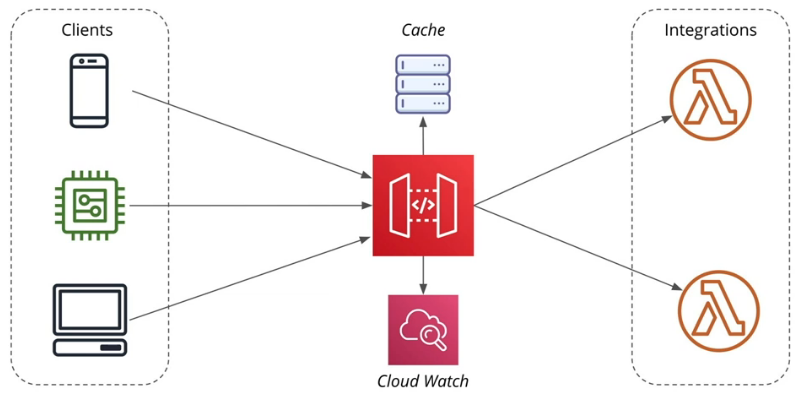
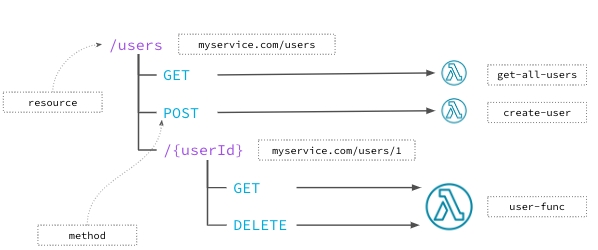
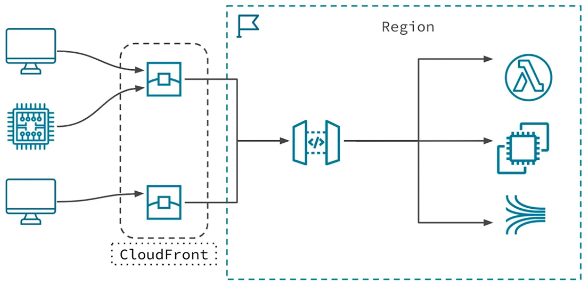
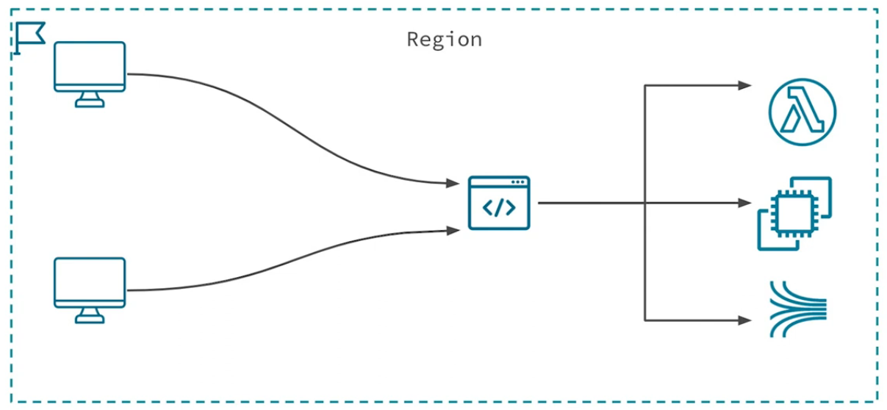
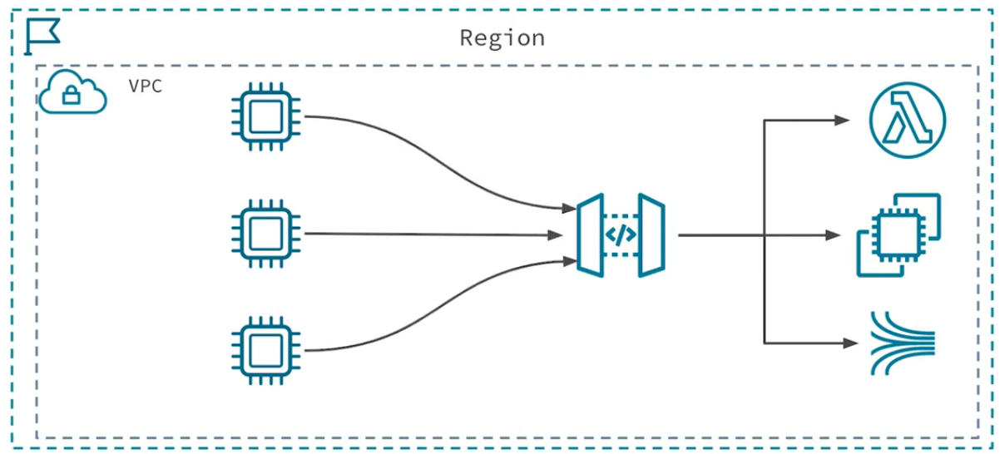
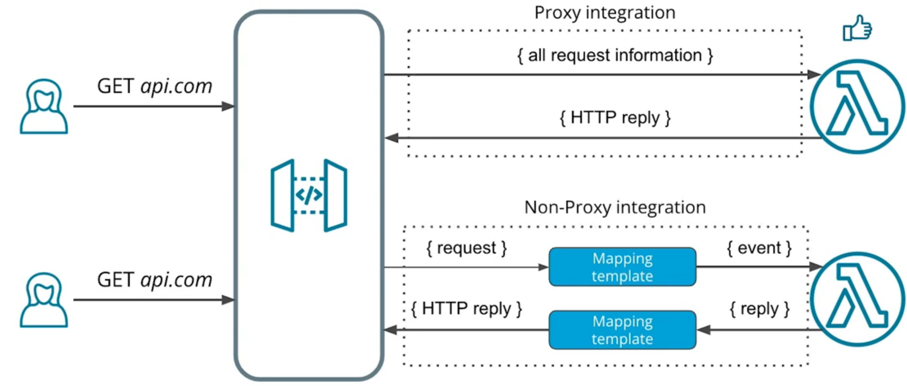
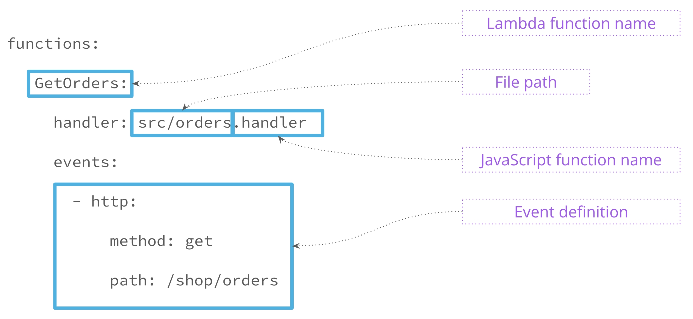
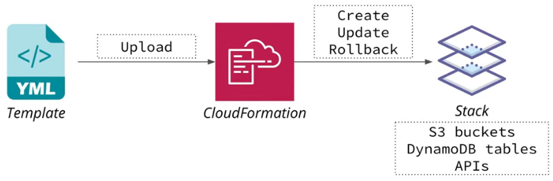

# REST API

## 1. API Gateway
When implementing REST API with AWS Lambda our functions receive HTTP requests in the form of events. Each event contains information like HTTP method, HTTP body, headers, etc.

A Lambda function should process this event and return a response that will be converted by AWS into an HTTP response.

What is API Gateway:
* Entry point for API users
* Pass requests to other services
* Process incoming requests



### 1.1 API Gateway Targets
Possible targets for an HTTP request processed by API Gateway:
* Lambda Function - call a Lambda function
* HTTP Endpoint - call a public HTTP endpoint
* AWS Service - send a request to an AWS service
* Mock - return a response without calling a backend
* VPC Link - access resource in an Amazon Virtual Private Cloud (VPC)



### 1.2 API Gateway Configurations
**EndPoint Configurations**

There are three primary types of endpoint configuration:
* **Configured per API**
* **Public**
    - **Edge Optimized Endpoint**: Amazon will automatically create CloudFront distribution and all requests will first go to this CloudFront distribution and then will go to API Gateway. Amazon has hundreds of CloudFront datacenters around the world, they are called point of presence, and when a request reaches CloudFront, after that it goes over Amazon Control Network and not over the public Internet. So it provides a better customer experience if your customers are distributed around the world.
        
    - **Regional Endpoint**: Requests go directly to API Gateway and this option makes sense if clients that use your API are located in the same AWS region.
         
* **Private VPC**: When creating API, it is placed in a Virtual Private Network (VPC) and then it will be isolated network in which our API will be available to users.
    

### 1.3 Lambda Integration Modes
* **Proxy** - passes all request information to a Lambda function. Easier to use.
    - HTTP request event
    ```json
    {
    "path": "/users/1",
    "headers": {
        "Accept": "application/json"
    },
    "httpMethod": "GET",
    "pathParameters": {
        "userId": "1"
    },
    "body": ""
    }
    ```
    - HTTP reply
    ```js
    exports.handler = async (event) => {
    return {
        statusCode: 200,
        headers: {
        "Cache-Control": "max-age=120"
        },
        body: JSON.stringify({
        "result": 42
        })
    }
    }
    ```
* **Non-proxy** - allows to transform incoming request using Velocity Template Language. That is the mapping template.
    

### 1.4 API Gateway Stages
* dev stage: api-gateway.com/dev
* staging stage: api-gateway.com/staging
* prod stage: api-gateway.com/prod

### 1.5 Serverless.yml



## 2. DynamoDB 
* NoSQL Database:
    - Key-value store - every item should have a key
    - Document datastore - every item can be a complex document
* Scalable Database
* Low Latency:
    - < 10ms
* High-Availability:
    - Ability to process requests without errors
    - 99.999% availability
* Serverless

### 2.1 DynamoDB Features
* Schemaless: except key fields.
* Query via API.
* ACID Transactions.
* Update Streams: React to updates in DynamoDB tables.
* Global Tables: Allows to have single table to have multiple copies in different regions and if any copy is updated all copies will be updated almost in real time.
* Back-ups.

### 2.2 Data in DynamoDB
* Store in multiple partitions.
* Partition key:
    * GetItem - get on item by key
    * Scan - get all items (optionally filter them). Scan will always go through all partitions and all items. Not efficient for large datasets.
    ```python
    import boto3

    dynamodb = boto3.resource("dynamodb")
    table = dynamodb.Table("Users")

    response = table.scan(
        Limit=20
    )

    items = response["Items"]

    print(items)
    ```

* Query:
    ```python
    import boto3

    dynamodb = boto3.resource("dynamodb")
    table = dynamodb.Table("GameScore")

    result = table.query(
        KeyConditionExpression="GameId = :gameId",
        ExpressionAttributeValues={
            ":gameId": "10"
        }
    )

    items = result["Items"]
    ```

### 2.3 DynamoDB Capacity Modes
1. **Provisioned capacity** - we need to define the maximum amount of read/write requests DynamoDB can handle. The higher the limit we set, the more we have to pay per month. Requests are throttled if we go above the specified limit.
    * Define 2 values per table:
        - RCU - read capacity units
        - WCU - write capacity units
    * The more units the more data can be read/written per second.
    * Pay even if you don't use it.
    * Supports auto-scaling.
2. **On-Demand** - DynamoDB will handle as many requests as we send, and we pay per-request. Can be more expensive comparing to Provisioned capacity, but is better for applications with unpredictable traffic patterns.

### 2.4 Composite Key
A composite key in DynamoDB consists of two elements

* **Partition key** - what partition to write the item to
* **Sort key** - to sort elements with the same partition key
Together - uniquely identify an item, meaning there can be no two items in a table with the same values of the composite key.

NOTE. If a table has a composite key, there can be multiple items with the same partition key, providing they have different values of the sort key.

Composite keys allow to perform queries that can be used to get a subset of items with a specified partition key.

### 2.5 Indexes Types
* **Local secondary index (LSI)**:
    - Like an additional sort key.
    - Allows to sort items by a different attribute.
    - Added on the data in a table.
* **Global secondary index (GSI)**:
    - Allows to define a new partition key for the same data.
    - Allows to define a new partition and sort key for the same data.
    - Creates copy of the data in a table (data is available via GSI after some delay).

## 3. Cloud Formation
CloudFormation is a services for creation and management of AWS resources. Like Terraform but for AWS. CloudFormation allows us to: 
* Write YAML/JSON config file.
* Changes state of AWS resources.
* Version control the infrastructure.
* CloudFormation is free and we only need to pay for created resources.



Template sections:
* Parameters - to configure execution.
* Resources - list of resources we want to create.
    ```yaml
    Resources:
    GroupsDynamoDBTable:
        Type: "AWS::DynamoDB::Table"
        Properties:
        TableName: Group
        AttributeDefinitions:
            - AttributeName: id
            AttributeType: S
        KeySchema:
            - AttributeName: id
            KeyType: HASH
        BillingMode: PAY_PER_REQUEST
    ```
* Conditions - to define when to create specific resources.
* Output - values returned in response.

## 4. UUID - Universally Unique Identifier
* 128-bit number
  - `ff9a8915-9bbf-4078-8dda-1ee091618f6b`

* Can be generated by our application
  - Very low probability of collisions.
  - No need to check if a particular ID exists.

## 5. Validate Requests
```json
{
  "$schema": "http://json-schema.org/draft-04/schema#",
  "title": "my-type",
  "type": "object",
  "properties": {
    "name": {
      "type": "string"
    }
  },
  "required": ["name"]
}
```

## 6. Exercise

Exercise - API Serverless:


```
serverless deploy
```

```
curl --location --request GET 'https://lyns5etnk0.execute-api.us-east-1.amazonaws.com/dev/groups'
```

```
npm install
```

```
npm start
```

```
curl --location --request POST 'https://lyns5etnk0.execute-api.us-east-1.amazonaws.com/dev/groups' \
--header 'Content-Type: application/json' \
--data-raw '{
    "name": "Name",
    "description": "2345"
}'
```

```
curl --location --request POST 'https://lyns5etnk0.execute-api.us-east-1.amazonaws.com/dev/groups' \ 
--header 'Content-Type: application/json' \ 
--data-raw '{ 
    "name": "Name", 
    "description": "Description" 
}'
```

Image Table
```
- `groupId` — **Partition key** ─┐
                                    ├── **Composite key**
- `timestamp` — **Sort key** ────┘
- `imageId`
- `title`
- `imageUrl`
```