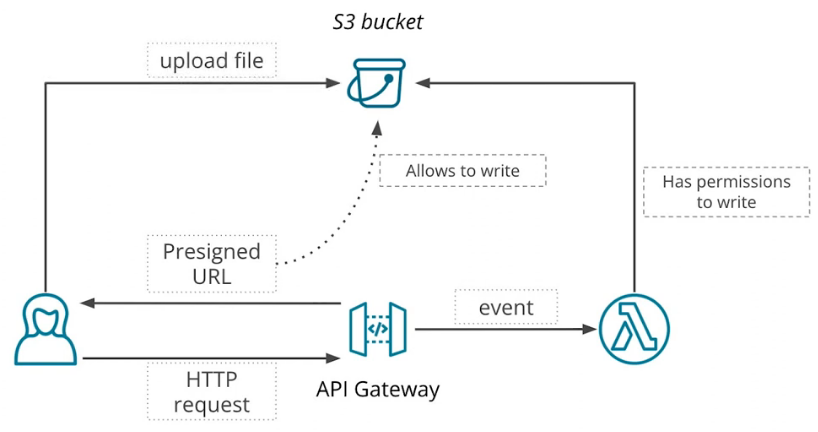
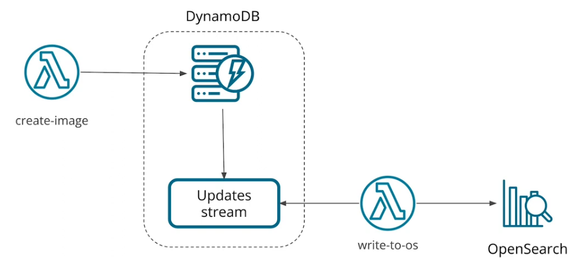
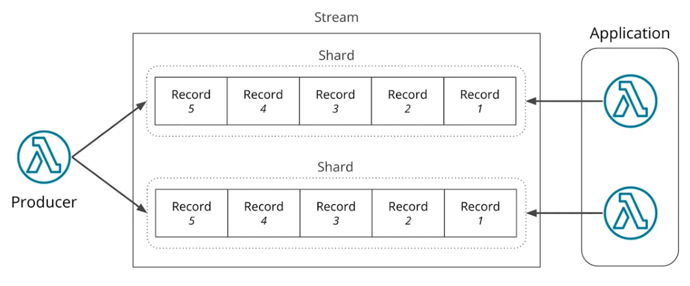
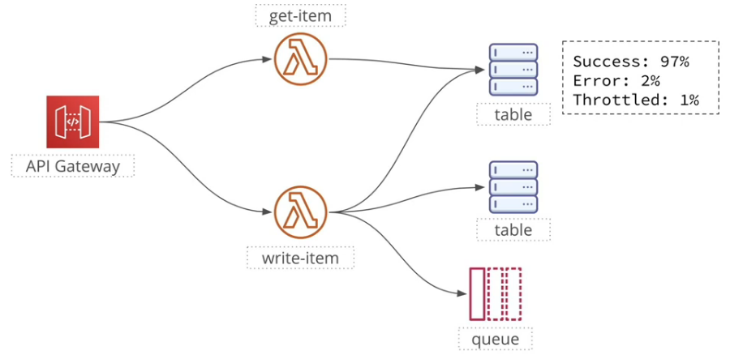
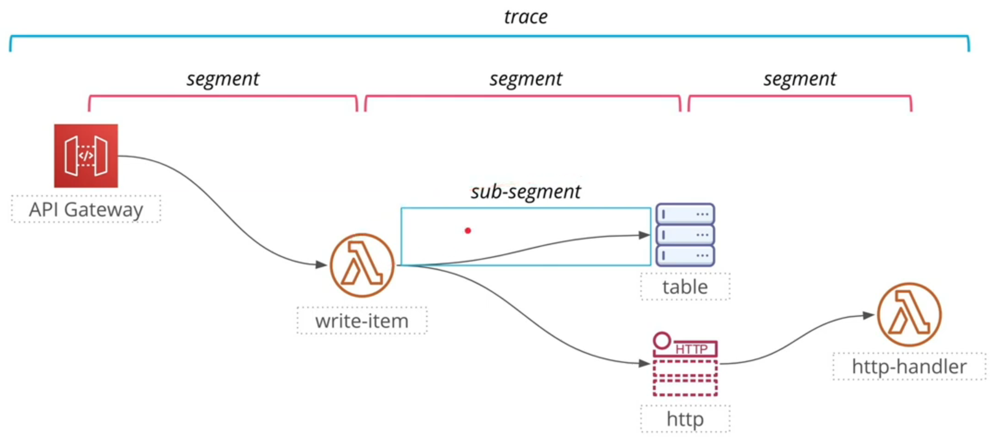

# Event Processing

## 1. S3 Pipeline
**Presigned URL** is a special URL pointing to an S3 bucket that can be used by anyone to upload/read an object. It can be used to access an S3 bucket even if it is private.



```python
import boto3
import requests

s3_client = boto3.client("s3")

# The resulting URL allows a PUT operation.
presigned_url = s3_client.generate_presigned_url(
    ClientMethod="put_object",
    Params={
        "Bucket": "s3-bucket-name",
        "Key": "object-id",
    },
    ExpiresIn=300,  # URL is valid for 5 minutes
)

print(presigned_url)

# Upload
with open("example.jpg", "rb") as file:
    response = requests.put(presigned_url, data=file)

response.raise_for_status()
```
---

`Ref` is a function in CloudFormation that allows to get an id of a resource. In YAML files we can use one of the two forms:
* `Ref: logicalName`
* Short form: `!Ref logicalName`

`Ref` function will return different values depending on what resource type it is used with.

---

Unlike a traditional file system, `S3` does not have folders. Instead, each bucket contains a flat list of objects, each with a unique name called a key. Keys can contain “/“ symbols, but they are not treated in any special way by `S3`.

## 2. SNS
SNS is a service to send messages to other services.

It has two main concepts:

* **Publishers** - publish messages
* **Subscribers** - consume incoming messages

Publishers and subscribers communicate via topics:
* A publisher publish a message to a topic.
* A subscriber receives a message if it is subscribed to a topic.
* One topic can have many subscribers.
* Subscribers can use various protocols: Lambda, HTTP, email, SMS, etc.

## 3. Data Streaming
* Kafka/Kinesis
* DynamoDB updates stream

### 3.1 DynamoDB Stream
2 types of users:
* Consumers - read records.
* Producers - add new records.

Architecture for project



### 3.2 Scaling a Data Stream

DynamoDB:
* Every record has a key.
* Key is hashed.
* Hash is used to select the a shard.

Records are assigned to a particular shard using the record's key.



A data stream is split into shards, and every shard stores a subset of data. Different shards can spread across multiple hosts, which allows scaling up a data stream.

Every record that is added to a data stream has key and data, A key of a data record is used to decide what shard it will be written to. All items with the same key will be written to the same shard and will be available in the same order they were added to a stream.

Ordering is guaranteed within a shard, but not across different shards.

## 4. OpenSearch
Fork of another popular datastore called ElasticSearch:
* ElasticSearch license prohibits AWS from providing service.
* Amazon created a fork.

CloudFormation will create two services:
* Provides an API that we can use to upload data and queries.
* Provides a dashboard - UI for interacting with OS.

Not Serverless. Data is stored in a JSON format.

## 5. Serverless Observability
* Applications get more and more complex.
* A common pattern in modern applications:
    - Microservice architecture
    - Multiple independent components
* Lambda and FaaS push the complexity even further.

3 Pillars of observability:
* Metrics
* Logging: Recording individual events.
* Distributed Tracing: Recording information about end-to-end request execution. Distributed Tracing is a tool used to troubleshoot complex problems that involve multiple system components. AWS X-ray.
    - Benefit:
        -  Provides end-to-end view of the system.
            - Component interactions.
            - Errors.
            - Customer Impact.
        - Allows to identify errors.
        - Allows to identify performance issues.

    

    - Terms:
        - Trace - a single request.
        - Segment - each individual step in the execution of a request.
        - Sub-segment - each individual operation in a segment.

    
    
| Feature | X-Ray API | X-Ray Daemon |
|---|---|---|
| Type | Direct API requests | Separate application running on a server |
| Trace Submission | Uses `PutTraceSegments` | Receives and forwards tracing information |
| Communication | Synchronous | Asynchronous |
| Buffering | No | Yes |
| Latency Impact | Can impact application latency because it waits for a reply | Reduces application latency by buffering and sending asynchronously |
| AWS Lambda | Can be called directly | Integrated with AWS Lambda |

```python
import boto3
from aws_xray_sdk.core import xray_recorder
from aws_xray_sdk.core import patch

# Patch boto3 so DynamoDB requests are traced by X-Ray
patch(["boto3"])

# Create DynamoDB client/resource
dynamodb = boto3.resource("dynamodb")
table = dynamodb.Table("MyTable")

# Perform request — X-Ray automatically records a subsegment
response = table.get_item(
    Key={
        "id": "123"
    }
)

item = response.get("Item")
```
    


