# Implementing Authentication
* **Authentication** - application should know who the user is
* **Authorization** - application should know what a user can do

## 1. Authentication with API Gateway
* API Gateway is an entry point to our application.
* Several ways to implement authentication with API Gateway.
    - IAM authentication: Not good for mobile/web users. Sign a request to API Gateway with IAM credentials.
        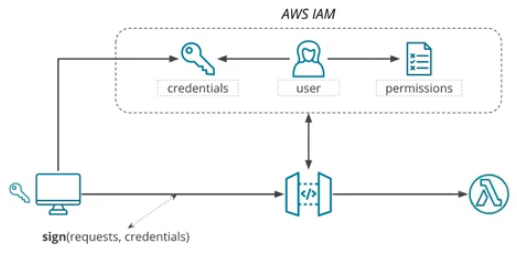
    - Amazon Cognito: API Gateway checks if a token passed with a request was issued by Amazon Cognito service.
        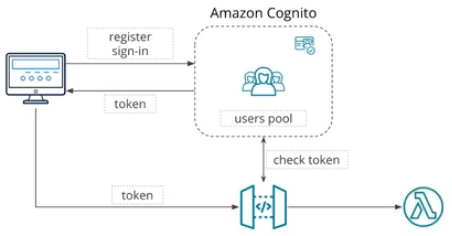
    - Cognito Federated Identity: Get temporary IAM credentials when providing a valid token from an identity provider.
        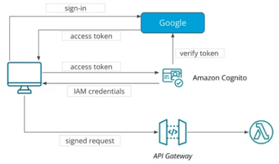
    - Custom Authorizer: Implement a Lambda function that verifies a token provided with a request. "Salted" hash of a password. Secure remote password protocol (SRP). Problems:
        - Email verification
        - Sign-in/sign-out
        - Password recovery
        - Social network login
        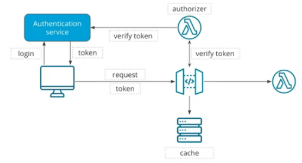
        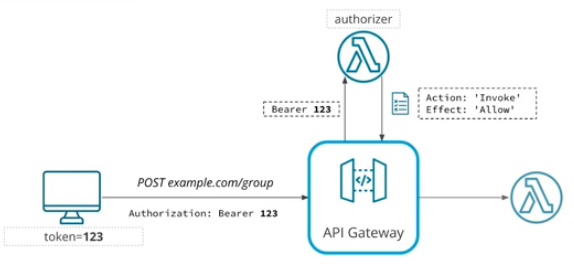

* **Bearer**: A bearer is anyone who has the authentication token and can use it to prove they have access.

## 2. Auth0 Service
Authentication and Authorization service. Supports:
* OAuth 2.0 and OpenID.
* Social network login
* Multi-factor authentication
* etc.

## 3. OAuth
OAuth essentially provides access to user accounts but restricts what operations may be performed by a 3rd party system. OAuth provides special credentials to enforce this type of restriction.

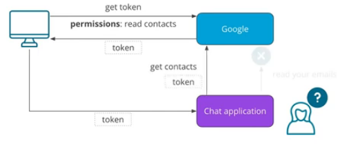

**OpenID**: Authentication on top of OAuth.

## 4. JWT Token
* www.jwt.io
* 3 parts:
    - header: sign algorithm
    - payload: info about the user
    - signature

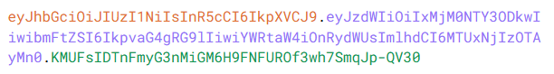

OAuth allows the use of 2 algorithms to sign a JWT token:
* Symmetric (HS256)
    - The same key for signing a token (by Auth0) and verifying a token (by our application)
    - We need to store this key and make it available to our application
    - If this key leaks, an attacker can sign fraudulent JWT tokens.
    
    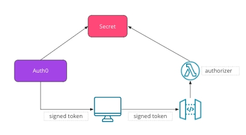
* Asymmetric (RS256)
    - Different keys are used for signing and verifying a token
    - Auth0 is responsible for storing a token
    
    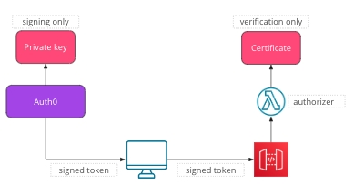

A **server-side cookie** is a type of cookie set by an HTTP server, but its value will not be available to JavaScript code running in a browser. A value of a server-side cookie is only available to a browser, and it will automatically send requests as a normal cookie. Since a cookie is not available to JavaScript code running in a browser, it cannot be accessed by any malicious code. If a JWT token is stored in a server-side cookie, it can be used for authentication in a more secure fashion.

Notice that in this course and in many other examples, online JWT tokens are stored in local storage. While this is a simpler option that is sufficient for demos, it is not secure and is discouraged.

## 5. Storing Secrets
Storing in environment variables:
* Not a good idea
* No centralised configuration
* Can be accessed by anyone who can access AWS console

Specialized service:
* SSM Parameter Store
    - For centralized configuration storage
    - Values can be encrypted
    - No additional charges
    - Encryption done by KMS
* AWS Secrets Manager
    - For storing secrets
    - All values are encrypted
    - Supports secrets rotation
    - Pay-per-request and per secret
    - Encyrption done by KMS
    - Reading secrets manager:
        ```python
        import boto3

        client = boto3.client("secretsmanager")

        response = client.get_secret_value(
            SecretId="secret-id"
        )

        secret = response["SecretString"]
        ```
* Non-AWS Service

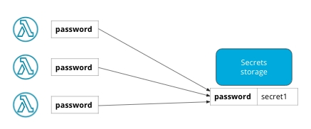

Key Management Service (KMS)

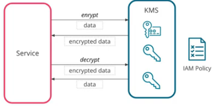

## 6. Lambda Middleware
* Middleware = code that runs in the middle of a request-processing pipeline.
* Middleware is commonly used for authentication, authorization, logging, error handling, validating requests, rate limiting, and modifying requests/responses.

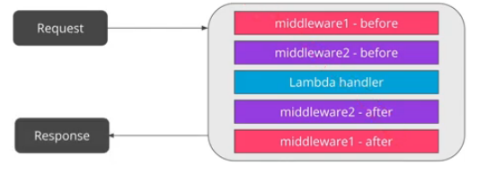

| Name               | Description                                                   |
|--------------------|---------------------------------------------------------------|
| http-cors          | Return CORS headers                                           |
| http-error-handler | Return HTTP error if an exception from http-errors is thrown  |
| secrets-manager    | Read parameters from AWS Secrets Manager                      |
| ssm                | Read parameters from the AWS Parameter Store                  |
| validator          | Validate incoming requests and outgoing responses             |

## 7. Security with Serverless
### 7.1 Our responsability
* Application security:
    - Old recommendations still apply.
    - OWASP Top 10 list still applies.
* Configuring IAM permissions:
    - Define what function/role can access what resoures.
    - Use the principle of least privilege.
* Data encryption
    - Enable encryption at rest for services like DynamoDB and Kinesis.
* Secrets handling.:
    - Use KMS, secrets manager, SSM.

### 7.2 Protect the API
* Use throttling
    - Can be configured per stage or per method
    - Throttle individual customers if applicable
        - API Key = not for authorization
        - Can set maximum number of requests per API key
* Validate incoming data
    - API Gateway or in your code
* Use a firewall to limit access to your API
    - AWS Web Application Firewall (WAF)

From a security perspective, it is best to set the minimum required privileges per function. Functions only need access to the set of resources they need.

This restricted access is implemented through the using the `serverless-iam-roles-per-function` plugin.
```yml
plugins:
  - serverless-iam-roles-per-function
```

## 8. Ports & Adapters
**Vendor Lock-In**: Inability to switch from a selected technology provider.

**Hexagonal Architecture**: Separate the application into 2 components:
1. Business Logic: Independent from external services.
2. Ports & Adaptors: Interact with outside services (DBs, message queues, etc.).

